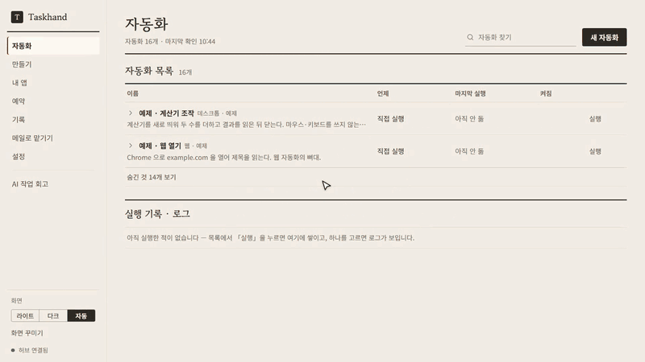
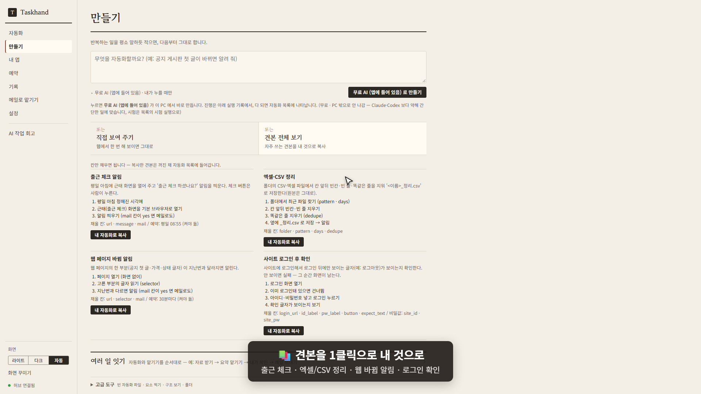
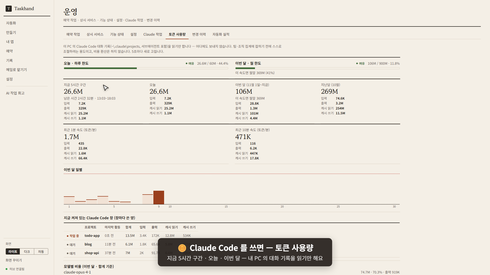

# Taskhand

A Windows tray app that runs repetitive office tasks on your own PC: scheduled jobs, monitors, backups and recorded UI automation, with optional AI help.

**Get it:** download `TaskhandPortable-<version>.exe` from [Releases](https://github.com/swbins/taskhand/releases/latest) and double-click it — no install, no admin rights (Windows 10/11). It unpacks into a `Taskhand-휴대용` folder next to the exe and starts; double-click again later and it starts right away. To remove it, turn off "start with PC" if you enabled it, quit from the tray, then delete the folder.

- **Scheduled jobs and workflows** — run at set times, chain several tasks in order (stops if one fails)
- **Watchers** — site/server checks, credential expiry warnings, folder tidy, backups, disk space
- **Show it once** — record a web task and replay it; one-click sample automations
- **Morning brief and weekly report** — tables without AI, optional AI polish
- **Hand off by mail** — send a request from your phone, the PC does it and replies
- **Alerts** — Slack, Teams, Discord, Google Chat, webhooks

Free, no usage limits, no account. No API key — AI is optional (a bundled local model, or a Claude Code / Codex / Gemini CLI subscription you already have). Runs locally; the hub listens on `127.0.0.1` only. The UI is in Korean.

[한국어 설명 ↓](#한국어)

---

## 한국어

**반복 업무는 한 번 보여 주면 끝** — 한 번 해 보이면 그대로 따라 하고, 정한 시각에 알아서 돌리는 Windows 업무 자동화 프로그램.
무료 AI 가 앱에 들어 있어 AI 요금이 없고, AI 없이도 기본 기능은 그대로 됩니다.

## 받기

👉 **[받기 (Releases)](https://github.com/swbins/taskhand/releases/latest)** — `TaskhandPortable-<버전>.exe` 하나 · **설치 없이 바로 실행 · 전부 무료, 개수 제한 없음**

- **Windows 10 / 11** · 관리자 권한 없이. 받은 exe 를 더블클릭하면 exe 옆 `Taskhand-휴대용` 폴더에 풀고 바로 띄웁니다(바로가기·「앱 및 기능」 등록 없음)
- 다음부터는 같은 exe 를 다시 더블클릭하면 바로 뜹니다. 새 판 exe 를 같은 자리에서 실행하면 업데이트(설정·기록은 그대로)
- PC 켤 때 자동으로 띄우려면 트레이 「⚙ 설정 → PC 켤 때 자동 시작」(기본 꺼짐 — 예약 자동화를 돌리려면 켜기)
- 끝낼 땐 자동 시작을 켰다면 먼저 끄고, 트레이 「종료」 → 폴더를 지우면 끝
- 처음 실행할 때 **「Windows의 PC 보호」** 창이 뜰 수 있습니다. 코드 서명을 하지 않은 개인 앱이라 그렇습니다 —
  **「추가 정보」 → 「실행」** 을 누르면 열립니다. 걱정되면 릴리스 노트의 SHA256 값과 비교하거나 [VirusTotal](https://www.virustotal.com/) 에 올려 보세요.
- 받은 파일 확인(PowerShell): `Get-FileHash .\TaskhandPortable-*.exe`

## 할 수 있는 것

- **직접 보여 주기** — 웹에서 한 번 해 보이면 그대로 따라 하는 자동화
- **견본 1클릭 복사** — 출근 체크 알림 · 엑셀/CSV 정리 · 웹 페이지 바뀜 알림 · 사이트 로그인 확인
- **예약 · 일 순서** — 정한 시각에, 여러 일을 순서대로(앞이 실패하면 멈춤)
- **지켜보기** — 사이트 · 서버 감시, 키 · 로그인 만료 예고, 폴더 정리 · 백업 · 디스크 감시
- **아침 브리핑 · 주간 업무 보고**(AI 없이 표로, AI 를 고르면 다듬기)
- **말로 부탁하기 · 고쳐 달라기 · 도우미** — AI 를 고르면 켜짐(개수 제한 없음)
- **메일 · 메신저로 일 맡기기** — 폰에서 메일로 부탁하면 PC 가 하고 답장, 내 자동화 원격 실행
- **알림 출구** — 슬랙 · Teams · 디스코드 · 구글 챗 · 웹훅
- **나만의 앱** — 작은 업무 앱을 만들고 exe 로 내보내기
- **화면 펫 · 꾸미기**(만화 스킨 · 모든 묶음), Claude Code 를 쓰면 **토큰 사용량** 탭

## 전부 무료

유료판도 개수 제한도 없습니다. 위 기능이 모두 들어 있고, 실행 횟수도 세지 않습니다. 돈이 드는 건 직접 고른 구독 AI 의 요금뿐입니다.

## AI 는 고를 수 있어요

| 고르는 것 | 비용 | 내용이 어디로 가나 |
|---|---|---|
| **무료 AI (앱에 들어 있음)** — 기본 | 무료 | PC 밖으로 안 나감. 처음 한 번 모델(약 3~5GB)을 받습니다 |
| AI 없이 | 무료 | 따라 하기 · 예약 · 감시 · 백업은 AI 없이 돕니다 |
| Claude Code · Codex · Gemini CLI | 각자 쓰는 구독 | **직접 골랐을 때만** 그 회사로 감 |

## 내 데이터

설정 · 실행 기록 · 비밀번호는 **이 PC 안**에만 있습니다(비밀번호는 Windows 가 이 사용자에게 묶어 암호화). 계정 가입 · 사용 통계 · 광고가 없고, 만든 사람에게 아무것도 보내지 않습니다.
허브 화면은 `127.0.0.1` 에서만 열립니다. 지우려면 트레이 「종료」 뒤 `Taskhand-휴대용` 폴더를 지우세요(예전 설치판은 Windows 설정 → 앱에서 제거).

- [개인정보 처리 안내](PRIVACY.md)
- [이용 약관](TERMS.md)
- [서드파티 고지 · 상표](THIRD-PARTY-NOTICES.md) · [LICENSE](LICENSE)

## 문의 · 버그 알리기

[Issues](https://github.com/swbins/taskhand/issues) 에 남겨 주세요. 비밀번호 · 회사 정보는 올리지 마세요.

---

Taskhand 는 개인이 만든 독립 앱으로, Anthropic · OpenAI · Google · Ollama 와 제휴 · 보증 관계가 없습니다.
이 저장소에는 설치 파일과 안내 문서만 있습니다.
